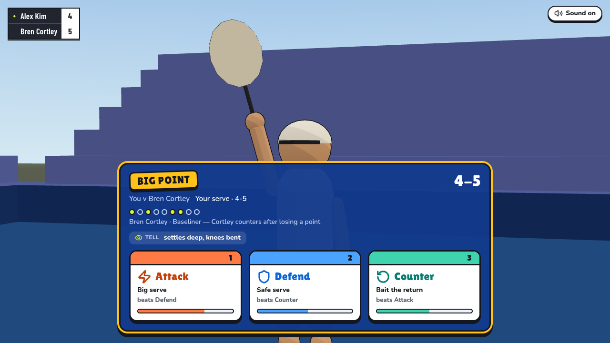
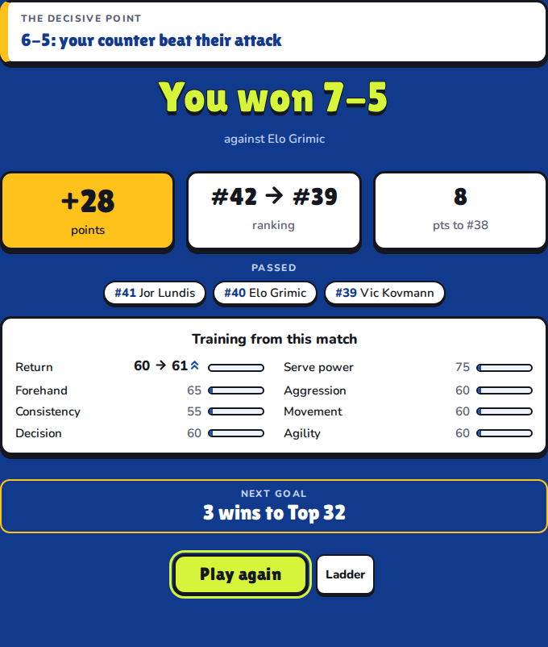

# TennisSim

A casual tennis management game for the browser. You don't swing the racket: you pick a game plan, read your
opponent, and choose a card at the big points of a one-tiebreak match. The match plays out as a short TV-style clip in
3D. Each match takes a minute or two and moves you up a ladder.



## How a quick match plays
- **Before the match:** the ladder shows your rank, the points to the next place, and your next opponent with a
  one-line scouting report of their habit. Pick a game plan (aggressive, balanced or defensive) and press Play.
- **During the match:** one tiebreak to seven, two clear. Points play on your plan. Once either player has five points,
  and at every set or match point, the match stops. The opponent's cards so far and a tell (right 6 times in 10) are
  shown; you pick Attack, Defend or Counter with 1/2/3. Each card beats one: Attack › Defend › Counter › Attack.
- **After the match:** the decisive point replays and the screen names your choice ("6-6: your counter beat their
  attack"). Then the ladder points count up, the players you passed slide in, your ratings tick up, and the next goal
  locks in.



A season mode (Football Manager-style career: calendar, training, tournaments) is one click away from the title screen.

## Run it
Requires Node 24.

```bash
npm install
npm run dev
```

Open http://localhost:5173/ for the game, or `/?seed=42&surface=clay&mode=full` for the replay viewer of a simulated
exhibition match. Other commands are listed in [CLAUDE.md](CLAUDE.md#commands).

```bash
npm test
```

Runs the Vitest suites (engine, game, renderer, ui). `npm run test:e2e` runs Playwright in Chromium, and
`npm run quick -- --n 2000 --seed 1` prints the quick-match balance report.

## How it is built
TypeScript (strict), Vite, Three.js, Vitest and Playwright, in npm workspaces:

| Package | What it does |
|---|---|
| `engine/` | Headless, deterministic point-by-point simulation that emits match events. Seeded RNG only. |
| `game/` | Headless career and quick-match layer on top of the engine: ladder, AI, personas, rewards, saves. |
| `renderer/` | Three.js replay of the events: broadcast cameras, toon look, score bug, synthesised sound. |
| `ui/` | DOM screens and overlays (the Vite root). |
| `e2e/` | Playwright specs, including screenshot baselines of the quick screens. |

The design lives in [GDD.md](GDD.md) (Korean) and [docs/casual-design.md](docs/casual-design.md). Decisions are
recorded as ADRs in [docs/decisions.md](docs/decisions.md), shortcuts in [docs/tech-debt.md](docs/tech-debt.md), and
open design questions in [docs/proposals.md](docs/proposals.md).

## Licence
MIT, see [LICENSE](LICENSE). The fonts (SIL OFL 1.1) and the Lucide icon paths (ISC) keep their own licences; see
[NOTICE](NOTICE).
