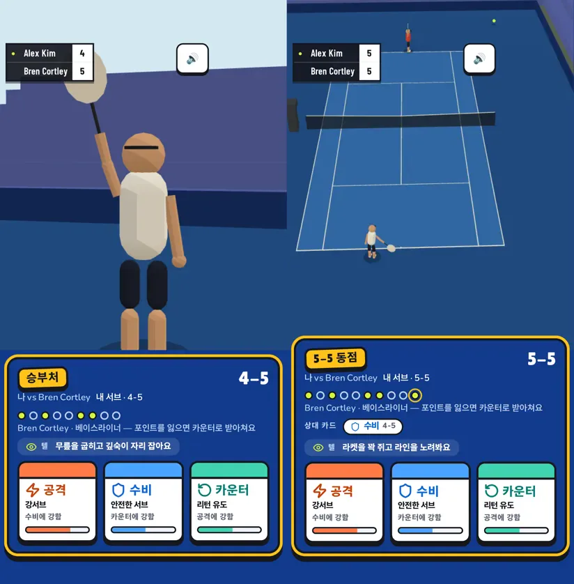
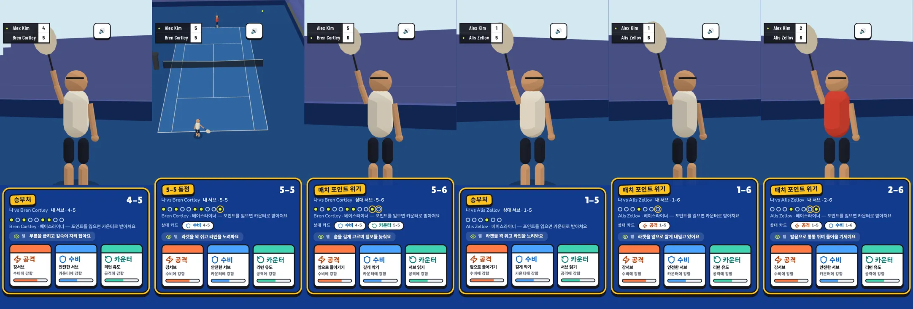
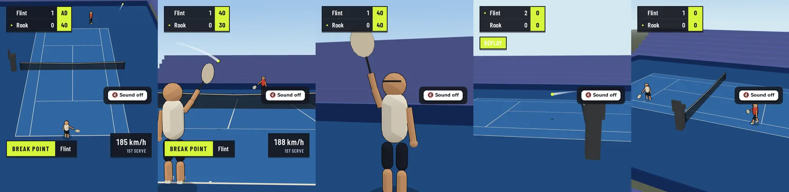
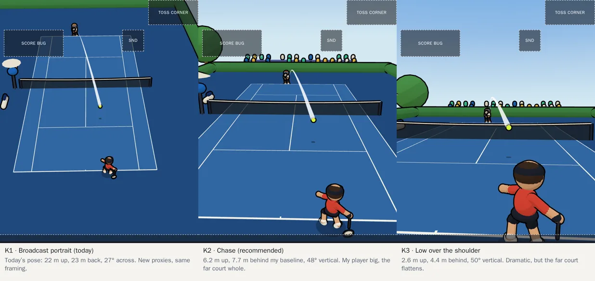
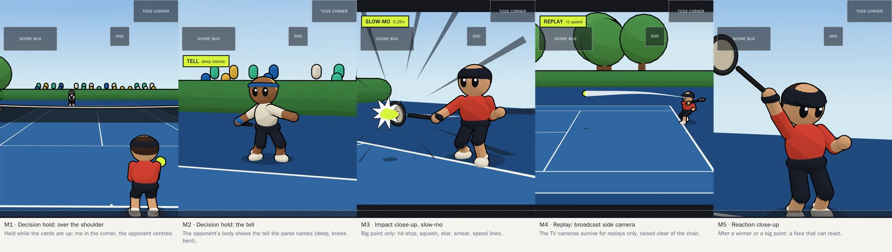
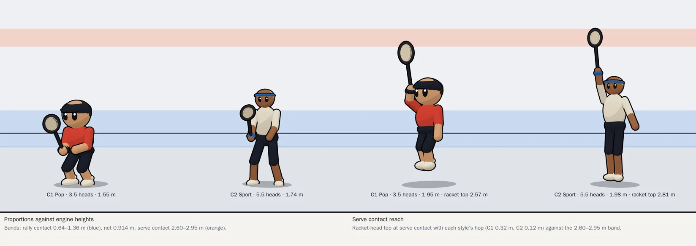
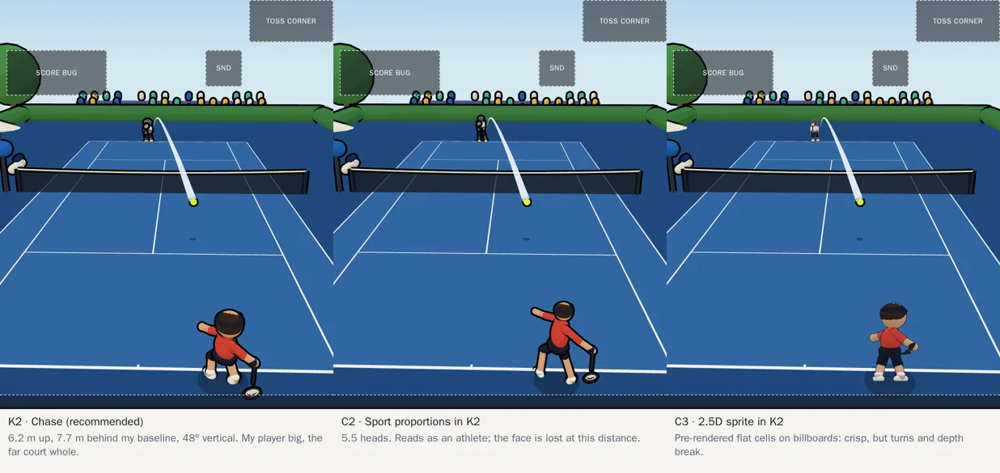
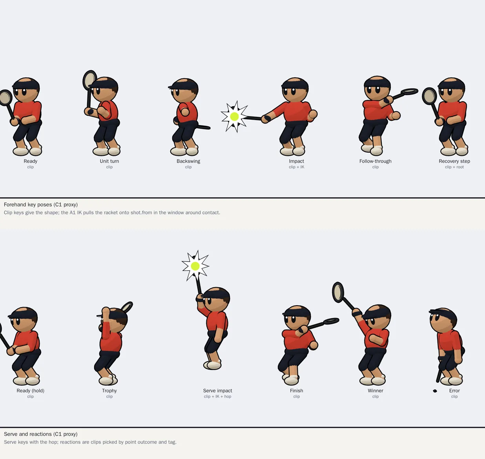
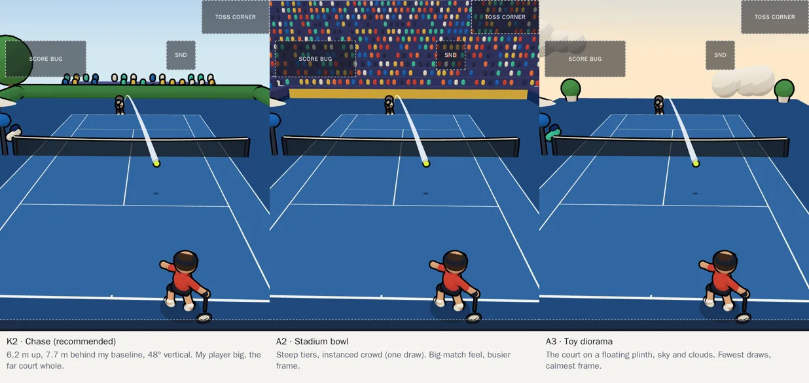

# 3D redesign: camera, character, motion and arena (design phase)

> **요약 (한국어)**
> - **진단:** 지금 3D는 TV 중계 문법을 세로 휴대폰에 억지로 맞춘 결과다. 결정 순간에 가장 오래 보이는 화면이 얼굴 없는 캡슐 등짝이고(서브 캠 정지), 랠리 화면에서 내 선수는 스테이지 높이의 약 10%(50px)이며, 코트를 바꾸면 내 선수가 먼 쪽 스코어 버그 아래로 간다. 포인트는 2배·3배속으로만 보여서 스윙이 0.1~0.2초에 지나간다. 마네킹은 손·얼굴이 없고 라켓이 주걱처럼 보이며, 런지 때 두 발이 미끄러진다.
> - **추천 조합:** 카메라 **K2 체이스**(내 선수 뒤 6.2m 높이, 항상 내 선수가 화면 아래, 시간에 대한 닫힌식으로 부드럽게 추적), 결정 홀드는 **M2 상대 텔 샷**, 승부처만 **M3 임팩트 슬로모**, 중계 카메라는 **M4 리플레이**에만. 캐릭터 **C1 Pop**(3–3.5등신, 얼굴과 모자로 식별, 서브 도달은 홉+팔 늘이기로 해결). 동작은 **D2 이펙터 키포즈**(손·발·골반·가슴 목표를 데이터로 저장하고 A1의 IK로 풀어 엔진의 타점에 정확히 맞춤)에 **CC0 KayKit 이동·리액션 클립**을 섞는다. 경기장 **A1 선샤인 클럽**(결승전용으로 A2 스타디움은 나중에).
> - **에셋 출처:** 무료 테니스 스트로크 클립은 없다(Mixamo 포함). 유료 모캡(Motion Cast $35)은 재배포 금지라 **공개 저장소**(c10dev/tennis-web는 public)에 넣을 수 없다. 그래서 스트로크는 직접 저작한 키포즈 데이터로, 몸은 수직 슬라이스에서 KayKit(CC0)으로 파이프라인을 검증한 뒤 최종 외형(의뢰 vs Tripo)을 정한다.
> - **예산:** 선수당 삼각형 5k 이하, 변형 본 32개 이하, 512² 팔레트 아틀라스 1장, 선수당 드로 4개(지금 약 30개). 3D 다운로드 합계 1MB(gzip) 이하로 첫 화면 이후 지연 로드.
> - **시안:** `docs/design/3d-redesign/frames/*.webp` (세로 412×503 스테이지, 지금 UI가 가리는 영역 표시). 프로토타입은 `docs/design/3d-redesign/proto/`.
> - **다음 단계:** 안 선택 → ADR 기록 → 포인트 하나짜리 수직 슬라이스(§8).

Design phase only (2026-10-16): no renderer, ui, engine or game code changes. Builds on ADR-007/009 (event-driven
replay), ADR-018/019 (Rally Pop), ADR-022 (portrait, quality tiers), ADR-023 (motion track A1) and
`docs/m3-assets-and-references.md` (rig, clip and tooling research, not repeated here). Track A steps A2–A5 are on
hold for this redesign; their goals are absorbed in §5. The user's brief: redo the 3D from design up, priority motion →
camera → character look → arena mood; mobile casual tone (Tennis Clash composition, Mario Tennis Aces exaggeration
and impact) in Rally Pop colours; a game camera instead of the TV broadcast; a rigged, toon-shaded glTF character
instead of the capsule mannequin; stroke key clips plus procedural impact alignment; 3D (2.5D sprites only as one
option to compare); low-end Android WebView at 30 fps with a first screen under 3 s, inside M7's quality tiers.

Images: `docs/design/3d-redesign/current/` (captures of today's build), `docs/design/3d-redesign/frames/` (style
frames). Frames are rendered by `proto/` (a standalone Three.js r186.1 page, primitives only, no assets): serve the
folder (`python3 -m http.server 5290 --directory docs/design/3d-redesign/proto`) and open `?frame=<id>`, or run
`node docs/design/3d-redesign/proto/capture.mjs <out-dir>` from the repo root. Every stage frame is 412×503, the Pixel 7's
60dvh stage (aspect 0.82), with today's overlays masked in: score bug, sound switch, Toss's top-right corner, the
decision panel's lip. **The figures are primitive proxies for proportion, silhouette and camera distance, not the
final character.**

## 1. Diagnosis: why today's 3D feels off

Captured from `npm run dev:toss` on a Pixel 7 profile (quick match, seeds 3 and 7) and the replay page at 412×503
(seed 42, hard, key points). Each finding names the code that causes it.

### 1.1 Camera and cutting
1. **Nothing picks the most-seen frame.** While the cards are up, the stage simply stays on the last frame of the
   previous point's window (`ui/src/quick/match.ts` `drawChoose` sets no camera). Decisions follow big points, where
   the director lays Reaction Cam over the landing (`broadcast/director.ts`), so in 5 of 6 captured holds the stage is
   a close-up of the *previous point's winner*, often the opponent, frozen mid-celebration (the sixth was the main
   camera). With no face the figure reads as seen from behind even when it faces the camera, the other player is out
   of frame, and nothing on screen relates to the decision or to the tell the panel describes.
2. **My player is small and not mine.** The portrait main camera (`camera/mainCam.ts`, `CAMERA.portrait`: 22 m up,
   23 m behind, 27° across) fits the whole doubles court across 412 px: the near player is about 50 px tall (10% of
   the stage), the far one about 35 px and drawn under the score bug, the ball 4.8 px even at 1.3×. The camera stays
   at one end through changeovers, so for half the match *my* player is the far speck. Nothing marks which player is
   mine.
3. **TV grammar on a phone.** Cuts come from broadcast rules (Serve, Reaction, Side, Hawk-Eye) built for a 16:9
   frame; in portrait the Reaction Cam crops to a racket and a chin, Side Cam shows a strip of court, and the side
   replay often has the umpire chair in front of the ball (TD-040). There is no shot that exists *for the game*: no
   impact moment, no tell, no "my shot" framing.
4. **Everything is fast-forwarded.** Card-less points play their last 1.6 s at 3× and decision points play at 2×
   (`QUICK_PACE.autoSpeed`, `.speed` in `game/src/tuning.ts`). A 0.6 s swing window (`RIG_MOTION.swing`) is on screen
   for 0.2–0.3 s; no amount of animation reads at that rate. Pacing must move from "speed up the whole clip" to "show
   less of the point at 1×, slow down the moment that matters".

### 1.2 Character and rig
5. **A test dummy, not a character.** `scene/rig.ts` builds the body from 8-segment capsules and boxes: faceted limbs,
   no hands, box feet, a head with no face, a visor brim that reads as a blindfold, a racket that reads as a paddle
   or a spoon. Two players differ only in shirt colour. Close-ups (Serve, Reaction) expose all of it.
6. **Proportions were scaled, not designed.** ADR-019 thickened M3's limbs and enlarged the head (radius 0.19) in
   tuning, so the figure is neither realistic nor chibi (TD-039).

### 1.3 Motion
7. **Swings are a fixed path, not a stroke.** Every groundstroke is the same yaw sweep in a fixed ±0.3 s window
   around contact (`scene/arm.ts` `swingAngles`, `RIG_MOTION.swing`), whatever the incoming ball's flight time,
   height, speed or spin. There is no unit turn, no backswing hold, no acceleration, no follow-through over the
   shoulder: no anticipation, so no impact.
8. **Alignment slides the body.** A1 meets the ball exactly (ADR-023), but by leaning the torso and sliding the hips
   up to 0.9 m sideways: both feet skate with the shadow (TD-058). The gait is a fixed 1.4 Hz cycle scaled by speed
   (`playback/pose.ts`), so feet slide whenever speed changes. The serve jump is 0.4 m on a 1.75 m figure.
9. **No acting.** Reactions are an arm raise or a lean; no head tracking of the ball, no between-point business.

### 1.4 Arena
10. **Grey boxes on a navy floor.** Stands are flat navy slabs, boards and the umpire chair are boxes
    (`scene/venue.ts`, TD-041); from the high portrait camera most of the frame is court and surround, and the
    bottom fifth is empty surround under the panel's lip. There is no depth cue between the court and the sky.

What works and stays: the event-driven, closed-form replay (ADR-007: any frame from replay time alone, so seek,
replays and speeds are exact), the toon bands and constant-pixel ink outlines (ADR-019), the optic ball with trail and
contact pop, the Rally Pop palette, the A1 two-bone IK and contact targeting, the eased facing (TD-057), and M7's
quality tiers.

## 2. References

Research 2026-10-16. "[shot]" = measured from official store screenshots, "[snippet]" = search summary only; the
rest was read on the page. Images are linked, never copied.

| Reference | Camera | Character | Motion and impact | Take |
|---|---|---|---|---|
| **Tennis Clash** (Wildlife, mobile, portrait 9:16) | High three-quarter from behind *your* end, you always at the bottom: far baseline 16–20% down, net 41–43%, near baseline 78–96%; at the net the camera dollies forward (net 54% down) and pans with the player [shot]. Swipe to hit, tap to move; first to 7 points ([GameAnalytics](https://www.gameanalytics.com/blog/how-tennis-clash-scored-a-golden-set), [Level Winner](https://www.levelwinner.com/tennis-clash-guide-tips-cheats-tricks-to-become-a-grand-slam-champion/)) | Stylised realism, about 7 heads, slightly large heads and hands, bold two-tone kits [shot]. Near player 15–17% of screen height, far 8% [shot] | Strokes caught at full extension, free arm pointing; cyan-to-white ball trails on court [shot] | The chase composition, the dolly with my depth, never flipping ends |
| **Mario Tennis Aces** (Camelot, 2018) / **Fever** (2026) | Landscape, high behind the near baseline; Zone Shot cuts to first person with darkening and a vignette; Special Shots play a short per-character camera move ([mariowiki Zone Shot](https://www.mariowiki.com/Zone_Shot), [Special Shot](https://www.mariowiki.com/Special_Shot_(Mario_Tennis_Aces))) | Mario about 2.5–3 heads [shot]; read by head, cap, gloves, shoes | Zone Speed slows time; white bloom at the racket, afterimages on specials [shot]. Trail colour per shot type: topspin red, slice blue, flat purple, lob orange/yellow, drop white ([Aces](https://www.mariowiki.com/Mario_Tennis_Aces), [Fever](https://www.mariowiki.com/Mario_Tennis_Fever)). Fever was praised for flow "without constant slo-mo interruptions" (Nintendo Life via mariowiki) | Exaggerated keys, impact flash, trail colour by shot; slow-mo rationed |
| **Mini Tennis: Perfect Smash** (Miniclip) | High behind the baseline [shot] | 2.5–3 heads, big heads [shot] | Green ring under the player, sparkle trail on the ball [shot] | Closest chibi mobile reference; a ground ring marks "mine" |
| **Tennis Arena** (Helium9, portrait) | Low, close over the shoulder: near player about 50% of screen, far baseline unclear [shot] ([App Store](https://apps.apple.com/us/app/tennis-arena/id1551093164)) | Realistic, about 7.5 heads | — | Shows the cost of a low camera: the far court flattens |
| **Badminton Clash** (SoFunny, portrait, 1–2 min matches) | High behind the near player, whole court [shot] ([Play](https://play.google.com/store/apps/details?id=com.sofunny.superbadminton.global&hl=en)) | Small figures | Swipe prompts drawn on the court | Portrait + short matches, our format |
| Shapiro, [Camera angles in sports games](https://www.gamedeveloper.com/design/approaching-camera-angles-in-sports-games) | End-on default camera even when a TV one exists; baseball shows the pitch from behind the batter, then cuts wide | | | Serve shot → rally shot |
| Nesky, [50 Game Camera Mistakes](https://gamedeveloper.com/design/video-50-common-game-camera-mistakes----and-how-to-fix-them) (GDC 2014) | "Cameras are most noticeable when they fail" | | | Few, rule-driven cuts |
| Sakurai on [hit-stop](https://sourcegaming.info/2015/11/11/thoughts-on-hitstop-sakurais-famitsu-column-vol-490-1/) | | | Both sides freeze, longer for harder hits up to a cap; the hit character shakes; typical 50–100 ms [snippet] | Hit-stop on decisive shots only |
| Chibi ratios ([Clip Studio](https://tips.clip-studio.com/en-us/articles/4868), [snippet]) | | 2, 2.5, 3, 4 heads; at 3 the nose often goes, at 2 the neck | | 3–3.5 heads keeps a neck and readable limbs |

Not found: Tennis Clash's close-ups, slow-mo or replay behaviour, any Wildlife or Camelot talk on camera or animation.

## 3. Camera language

### 3.1 Options for the live rally camera
| | K1 Broadcast portrait (today) | **K2 Chase (recommended)** | K3 Low over the shoulder |
|---|---|---|---|
| Pose | 22 m up, 23 m behind, 27° across | 6.2 m up, 7.7 m behind my baseline, 48° vertical, aimed 10.8 m ahead of my player | 2.6 m up, 4.4 m behind, 50° vertical |
| My player | ~50 px (10% of stage) | ~85 px (17%), feet above the panel lip | ~170 px and more (35%+), cut by the panel |
| Far court | Whole court, far player under the score bug | Far baseline ~35% down, below the score bug; far player ~30 px | Far court flattened to a strip near the horizon |
| Reads | Tactics | My shot and where it goes | My body; aiming depth lost |
| Cost | — | Fewer far-stand pixels than K1 (sky fills the top) | Near player's fill and overdraw |

K2 is Tennis Clash's composition fitted to a squarer stage (0.82 against 0.56): the court converges more steeply so
both baselines and the doubles alleys at the far end stay in frame while my player is large.

### 3.2 Shot list (game camera)
| Shot | When | Framing | Frame |
|---|---|---|---|
| **S1 Chase** | Default during live play | K2. Always behind *my* player: at a change of ends the camera cuts to the other end during the changeover, so I am never the far player. "Me" is a new broadcast input (`me: PlayerId`); the quick match passes the user's player, the replay page and the season mode default to A | K2 |
| **S2 Decision hold: the tell** | While the cards are up (a big point) | Low, mid-court, on the opponent in the pose their tell names (deep stance, early split step, racket back…), face visible | M2 |
| S2b Decision hold: over the shoulder | Alternative to S2; also the lead-in to my serve | Behind my server, me in the lower right, the opponent centred | M1 |
| **S3 Impact** | The decisive shot of a big point only (winner, ace, break/set/match point won), at most once per point | Close, low, side-on to the hitter; hit-stop then slow motion through contact | M3 |
| **S4 Reaction** | After a decisive point, the point's winner (or my player) | Front three-quarter close-up at head height; the face carries the reaction | M5 |
| **S5 Replay** | Kept broadcast cameras: Side (raised clear of the chair, TD-040) and Hawk-Eye on close calls | Letterboxed, `REPLAY` chip, half speed | M4 |

Scope: the game camera and shots S1–S4 apply to the quick match (the shipping mode) and the dev replay page; the
season mode's full/key/highlights viewing keeps today's broadcast director until the season mode is reworked, since
the camera module is chosen per broadcast.

### 3.3 Transition rules
- **Cut only on dead ball or on the hit-stop.** Never mid-rally except into S3 at the decisive contact. A shot lasts
  at least 1.0 s of screen time.
- **No camera flips between points.** The camera's end changes only inside a changeover (which the quick match skips
  past anyway).
- **Live play at 1×.** Show less of a point instead of speeding it up: the quick match shows the last 2–3 shots of a
  decision point at 1× (about 2–4 s), card-less points as their final shot plus the landing (about 1.5 s) or the
  ticker only. This replaces `QUICK_PACE.speed`/`autoSpeed` and needs a game-layer pace change (`clipFor`), owned by
  the quick-match flow, not the renderer.
- **Slow motion is rationed:** S3 on at most one point in four decisions; never two in a row (Fever's lesson).
- **Hit-stop:** 70 ms (≈4 frames at 60 fps) on S3, 40 ms on any winner in S1; the hitter shakes ±2 px, the ball
  squashes. Presentation only: the match clock does not stop, the programme inserts a rate-0 clip.

### 3.4 Determinism and smoothing
The camera stays a pure function of replay time (ADR-007), as every pose already is. Today's `dampPan` keeps
per-frame state in the UI; the chase camera instead **samples the timeline over a window** (my position and the ball
at t ± 0.4 s, weighted by a smoothstep kernel) the way `playback/facing.ts` `walkTurn` smooths a walk. Seek, replays and
speeds then show the same frame for the same time. Hit-stop and slow motion are programme clips (`rate` 0 and 0.25),
like today's Hawk-Eye clip, so they are seekable too.

**As built (ADR-024 step 4):** 7.4 m behind *my player* (following my depth both ways), 6.2 m up, aimed 15.8 m down
the court from the camera, 0.75 of my x, no ball term (a windowed ball jumps when it appears or vanishes), 48°
vertical from 0.82 up to a square view. The design numbers below were the starting point.

Chase rig as designed (tuning, `renderer/src/tuning/camera.ts`): x = 0.5 · my x + 0.15 · ball x (windowed); z = my end's
baseline + 7.7 m, dollying forward by 0.5 × how far my player is inside the baseline (net approaches); height 6.2 m;
aim 10.8 m ahead, x = 0.4 · my x; vertical FOV 48° at aspect ≤ 0.82, and on wider screens the same vertical FOV (the
landscape web build simply sees more width). Safe frame: the far baseline must sit below 25% of the stage height
(the score bug and Toss corner band) and my feet above 92% (the panel lip).

## 4. Character design

### 4.1 The constraint
The renderer draws the engine's metres and may not change them: net 0.914 m, rally contact 0.64–1.36 m, serve contact
2.60–2.95 m (median 2.79). A chibi body must reach a 2.8 m serve and a 0.64 m low ball at full adult height, or the
IK cannot meet the ball. So the big head comes from the head, not from a shorter body.

### 4.2 Options
| | **C1 Pop (recommended)** | C2 Sport | C3 2.5D sprite |
|---|---|---|---|
| Proportions | 3–3.5 heads at about 1.7 m (head ≈ 0.5 m), short arms, big hands and shoes, oversized racket head (0.34 m) | 5.5 heads at 1.85 m, Tennis Clash-like | C1 pre-rendered to sprite cells (8 directions × poses) on billboards |
| Face | Large eyes readable at S4 and S2 distance; expressions by swapping a face-texture cell | Small; lost beyond close-ups | Painted per cell |
| Silhouette and identity | Cap vs headband vs hair shape, kit colour block, wristbands, a ground ring under *my* player | Kit and hair only | As C1, flat |
| Serve reach | Proxy: 2.25 m standing, 2.57 m with a 0.32 m hop. A 0.35 m hop plus 12% stretch of the 1.36 m arm-and-racket chain (0.16 m) gives 2.76 m, the median serve, not the 2.95 m top. Levers: hop scaled by contact height (0.3–0.5 m), stretch up to 20% at contact (squash and stretch suits the style), or arms 0.05 m longer per segment | Proxy: 2.69 m standing, 2.81 m with a 0.12 m hop; the 2.95 m top needs a 0.26 m hop | Cannot bend to a contact point at all |
| Fit with brief | Mario-like exaggeration, Rally Pop toy box | Closer to Tennis Clash, less personality | Crisp in K2, but turns, camera moves and IK impact alignment break; textures cost megabytes |
| Risk | Auto-riggers fail on non-standard proportions (Meshy's docs warn of it) | Generic | High asset volume, no closed-form alignment |

**Recommendation: C1 Pop.** It is the only option whose face and gesture survive the phone's sizes, and it carries
the brief's Mario-style exaggeration. C2 is the fallback if the user prefers sport realism. C3 is rejected: it cannot
meet the ball (§5), and a sprite set per kit costs more bytes than a skinned mesh.

### 4.3 Kit and identity
- Shirt is the kit colour (today's per-surface rule, ADR-019: no shirt near its court's hue, nothing near the ball's
  hue). Shorts navy, shoes white, wristband and cap or band in the trim colour.
- Player A and B use one mesh; kit, hair and headgear are palette swaps (a 64×1 swatch row per kit) plus two or three
  headgear/hair meshes toggled by visibility. Per-player appearance later (GDD player creation) adds rows, not meshes.
- *My* player gets a ground ring in the accent colour (Mini Tennis's device) so the camera and the eye agree on who is
  me after a change of ends.

### 4.4 Budgets (targets; confirm on a device, TD-059)
Today at the main camera: 110 draws and 5.9k triangles for the whole stage (ADR-019, TD-038), of which the two
mannequins are about 30 draws (outlined parts doubled). The proto's primitive figures are about 50 draws each, which is
why a skinned mesh is a performance gain, not a cost.

| Item | High tier | Low tier |
|---|---|---|
| Body triangles per player (incl. head, hair, headgear) | ≤ 5,000 | same mesh |
| Racket | ≤ 300 triangles, rigid on a hand/racket bone | same |
| Deform bones | ≤ 32 + 1 racket socket; ≤ 4 weights per vertex | same |
| Textures | One shared 512² toon palette/face atlas (PNG ≤ 40 KB), one 64² kit swatch; no normal maps | same |
| Draws per player | Body, body hull, racket, racket hull: 4 | 2 (no hulls, as today's low tier) |
| Whole stage | ≤ 110 draws, ≤ 60k triangles | ≤ 70 draws, ≤ 40k triangles |
| Downloads (meshopt-compressed glb, gzip) | Player mesh ≤ 250 KB (one file, both players), stroke keys as data in code, CC0 locomotion/reaction clips ≤ 300 KB, arena ≤ 300 KB: **≤ 1 MB total**, fetched after the first screen (the ladder home is DOM) and prefetched while the ladder shows | same |
| CPU per frame | Pose, IK and mixer for two players ≤ 2 ms on the low-end target | same |

The ink hull on a skinned body must itself be skinned (a second `SkinnedMesh` sharing the skeleton): the vertex cost
doubles, which is why the low tier drops hulls. Meshopt's decoder ships inside three (`examples/jsm/libs/
meshopt_decoder.module.js`, about 8 KB gzipped, no extra files); skip Draco (no animation) and KTX2 (about 260 KB of
transcoder for one 512² atlas).

## 5. Animation pipeline

### 5.1 Sources (verified 2026-10-16; license classes as in the m3 doc)
**The repository is public** (`c10dev/tennis-web`), so assets licensed "use in a product, no redistribution of raw
files" cannot be committed, raw or baked.

| Source | Tennis strokes? | License | Fit |
|---|---|---|---|
| KayKit Adventurers + Character Animations | No (Hit, Cheer, Dodge, Running_Strafe, Jump, Idle…) | **CC0** ([LICENSE.txt](https://github.com/KayKit-Game-Assets/KayKit-Character-Pack-Adventures-1.0), read directly) | Chibi body (about 2.3 heads, 7k tris, 41 joints of which ~18 IK helpers, `handslot.r`), 76 clips per glb; locomotion and reactions |
| Mesh2Motion | No (Golf_Drive, OverhandThrow, Strafe) | **CC0** (repo `LICENSE-CC0.MD`) | Realistic, 66 UE-style joints with clavicles; reference and retarget source |
| Quaternius base characters / UAL | No | Pack pages say CC0, but [quaternius.com/license](https://quaternius.com/license.html) is now **QAL v1.0** (2026-08-28): no standalone redistribution, which a public repo arguably is | Avoid for new downloads |
| Mixamo | **None** (searched: tennis, forehand, volley; nearest Baseball Hit, Golf Drive, side steps) | No raw redistribution | Pose reference only |
| Motion Cast Tennisman #13 | **Yes**: 68 mocap clips (3 serves, 18 spot shots, 6 running shots, slices, drops, smashes, 10 moves, 8 reactions), 30 fps, .blend only | Superhive Royalty Free: no redistribution, $35 ([pack](https://superhivemarket.com/products/tennisman-animations---motion-cast13-vol)) | Realistic timing, needs Blender retarget; cannot live in the public repo |
| Cascadeur | Tool | Free tier non-commercial; Indie $96/yr with glTF export ([plans](https://cascadeur.com/plans)) | Hand-keying, if keys outgrow code |
| DeepMotion / Move.ai / Plask (video to mocap) | From our own video | Paid tiers for commercial output | Realistic and noisy: wrong timing for a chibi |
| Tencent HY-Motion, Hunyuan3D | — | Licenses **exclude South Korea** | Do not use |
| Bandai Namco Motiondataset, AMASS | No | Non-commercial | Do not use |

No free source has tennis strokes; the one cheap mocap pack is realistic and unshippable from this repo. The
procedural stroke layer A1 began is therefore the core, not a gap filler.

### 5.2 Options
| | D1 Mocap clips + IK fix-up | **D2 Effector key poses + IK (recommended)** | D3 Hand-keyed bone clips |
|---|---|---|---|
| What | Motion Cast clips retargeted in Blender, picked by height and approach (TopSpin-style grid), IK pulls the racket onto contact | Each stroke is 5–7 keys of *effector* targets (racket hand, racket direction, free hand, both feet, pelvis yaw, chest turn and lean, crouch, head look), timed relative to contact; IK solves arms and legs on any humanoid skeleton | Strokes keyed per bone in Cascadeur/Blender, exported as glTF clips |
| Look | Realistic, fights the chibi body | Snappy pose-to-pose with holds and overshoot (Mario timing); proven in the proto | Best hand-crafted look |
| Engine sync | Clip time-warped to contact | Native: keys are anchored to `shot.t`, targets to `shot.from` | Time-warped |
| Assets / license | $35, Blender, not in the public repo | None; data in `renderer/src/tuning/` | Tool subscription or a commission ($200–1,000 per clip, [RocketBrush](https://rocketbrush.com/blog/game-art-outsourcing-prices-complete-pricing-breakdown)) |
| Retarget | Needed | Not needed (targets are in metres) | Per skeleton |
| Determinism | Clip sampling is closed-form | Closed-form | Closed-form |

**Recommendation: D2 for strokes and the serve, CC0 KayKit clips for locomotion and reactions.** D2 reuses A1's
`scene/ik.ts` solver and its contact targeting, needs no retargeting, keeps the stroke layer in code where tests can
reach it, and fits the chibi timing. If the user later wants richer strokes, D3 keys can replace individual D2 keys
without changing the sync model.

### 5.3 Syncing with engine events
Everything stays a closed-form function of replay time from the events (ADR-007); nothing in the engine or the event
schema changes.

- **Stroke timing.** Per shot, the planner reads `t` (contact), `from` (contact point), `wing`, `shot`, `speedKmh`,
  `spinRpm` and the incoming ball's flight (the previous shot's `t` and `bounce`). Keys sit at fixed offsets from
  contact where there is time (backswing complete 0.18 s before, contact, follow-through 0.22 s after) and the unit
  turn starts as soon as the opponent's contact plus a reaction delay (0.15 s) allows; when the ball comes faster than
  the keys need, the early keys compress first, the forward swing (0.12–0.16 s) never does. Swing size follows
  `speedKmh`; a low-to-high finish follows `spinRpm`; contact height picks a deep crouch below 0.8 m.
- **Impact alignment (A1 reused).** In the contact window the racket-head target is pulled onto `shot.from` with
  `contactWeight` (ADR-023), solved by two-bone IK on the skinned arm; the remaining offset is taken by the chest lean
  and then **by the feet**: the planner chooses a plant for the front foot at contact (from `hitterPos` and the
  contact offset) and the step into it, instead of sliding the hips (closes TD-058).
- **Feet and gait.** Stride phase from distance travelled along the eased path (closed form over `movement.ts`'s
  trapezoid), so feet stop sliding; split step landing on the opponent's contact; recovery steps after a stroke.
  KayKit run and strafe clips are sampled with `AnimationMixer.setTime` (deterministic), blended by speed and
  direction against facing (shuffle, crossover, sprint).
- **Facing.** `playback/facing.ts` stays the root yaw; the chest and head add the stroke's turn and look at the ball.
- **Reactions.** Picked from the point's outcome and tags (fist pump on a winner, racket drop on an unforced error,
  bigger on break/set/match points), with face-cell swaps; between-point business (ball bounces before a serve).
- **Hit-stop and slow motion** are programme clips (§3.3); the pose functions do not know about them.

## 6. Arena mood

| | **A1 Sunny club (recommended)** | A2 Stadium bowl | A3 Toy diorama |
|---|---|---|---|
| Mood | Rally Pop's "sunny club court in a toy box": hedges, round trees, a small stand, umbrellas, benches | Big-match energy: steep tiers, crowd, boards | Floating plinth, clouds, a few props; the calmest frame |
| Depth cues in K2 | Hedge line and trees separate court from sky | Crowd wall behind the far baseline competes with the far player | Plinth edge and sky |
| Cost (proto, unmerged primitives) | About 110 draws for arena + court | 4,000 instanced capsules: 1 draw but 240k triangles; needs impostor cards (2 triangles per fan) | About 60 draws |
| Production | Merge static props into 2–3 meshes per material: ≤ 20 draws | Crowd as instanced cards with a 4-pose atlas, animated by a shader cheer on big points | Smallest |

**Recommendation: A1** for every match, with **A2 kept for later** (ladder finals, the season mode's big
tournaments) as a mood step-up. Surfaces keep their colours; the club dresses per surface (clay: terracotta walls and
cypresses; grass: white fences and ivy).

## 7. What happens to today's modules
| Keep | Rework | Replace |
|---|---|---|
| `playback/timeline.ts`, `ball.ts`, `movement.ts`, `clock.ts`; `scene/court.ts`, `ball.ts`, `ballMotion.ts`, `trail.ts`, `outline.ts`, `materials.ts`, `daylight.ts`; overlays; audio; `quality.ts` | `playback/pose.ts` → stroke planner (effector keys from events); `scene/ik.ts` and A1's `contactWeight`/`aimedTarget`/`contactShift` → IK layer on skinned bones; `playback/facing.ts` → root yaw only; `broadcast/programme.ts` → adds hit-stop and slow-mo clips; `broadcast/replay.ts` + the Side/Hawk-Eye poses in `camera/cameras.ts` → replay-only cameras | `scene/rig.ts` `MannequinRig` and `scene/arm.ts` meshes → `GltfRig` behind the same `PlayerRig` interface; `camera/mainCam.ts` and the portrait part of `camera/framing.ts` → `camera/chase.ts`; `broadcast/director.ts` → a game director (S1–S5 rules); `scene/venue.ts` → arena kit |

## 8. Recommendation and next step

**Recommended set:** K2 chase + S2 tell hold + rationed S3 impact + broadcast cameras for S5 replays only; C1 Pop;
D2 effector keys + CC0 KayKit locomotion and reactions; A1 sunny club.

**Next: a one-point vertical slice** (after the user picks; each step one local commit, TDD where it is code):
0. Record the choices as an ADR (next free number on main) and the debt as TDs; mark ADR-023's A2–A5 superseded.
1. **Body pipeline spike.** KayKit Adventurers (CC0) as the stand-in body: a Node script prunes it to one character,
   the deform bones and the needed clips, and writes a meshopt glb; `GltfRig` loads it behind `PlayerRig`, lengthens
   legs and torso by bone offsets towards 3–3.5 heads, mounts the racket on `handslot.r`, toon material plus a skinned
   hull. Tests: bone budget, triangle budget, the outline draw cap.
2. **Effector-key strokes.** Forehand, backhand and serve keys as data; the planner from shot events; IK on the
   skinned arms and legs; planted front foot. Tests: the existing contact accuracy (≤ 0.15 m p95) and racket
   continuity checks, no foot slide while planted, determinism.
3. **Gait and reactions.** Distance-based stride, split step, KayKit run/strafe/cheer clips via `setTime`.
4. **Chase camera and director.** `camera/chase.ts` (windowed, closed form), the S1–S5 rules, replay-only broadcast
   cameras; safe-frame tests at 0.75–0.85 aspects.
5. **Impact.** Hit-stop and slow-mo clips, squash, star, smear, speed lines, trail colour by shot type.
6. **One point end to end** (serve, a three-shot rally, a winner, the reaction, a replay) on the replay page and in the
   toss build at Pixel 7 size; frame times on the desktop GPU and the user's phone (TD-059), download size.

Out of the slice: the final character look (commission vs Tripo vs a modified KayKit, decided from the slice), the
quick match's pacing change (§3.3, game layer), A2 stadium, per-player appearance.

**Approvals the slice needs:** the KayKit Adventurers pack (CC0) committed in pruned form; `@gltf-transform/core` +
`@gltf-transform/functions` (MIT) as dev dependencies for the prune script, or three's own `GLTFLoader`/`GLTFExporter`
in Node first (as the m3 doc decided) with gltf-transform only if that falls short; no runtime dependency (meshopt's
decoder is in three). No Blender, no paid tools.

### Character production options (decided after the slice)
| | Modified KayKit | Tripo / Meshy mesh, re-skinned | Commission |
|---|---|---|---|
| Cost | Free; Blender time | Tripo Pro $19.90/mo for commercial output (unverified first-hand: terms page 403); 0.5–2 days cleanup | Freelance $100–500 per rigged low-poly character, 1–3 weeks (price sheets, [Pixune](https://pixune.com/blog/how-much-does-3d-art-outsourcing-cost/) for agency $1–6k) |
| Look | KayKit's chunky adventurer, stretched | Varies per run; auto-rig fails on chibi proportions | Exactly C1, to our skeleton and budget spec |
| License | CC0 | Paid-plan ownership | Work for hire (contract must grant CC0-compatible or full rights to commit to a public repo) |
