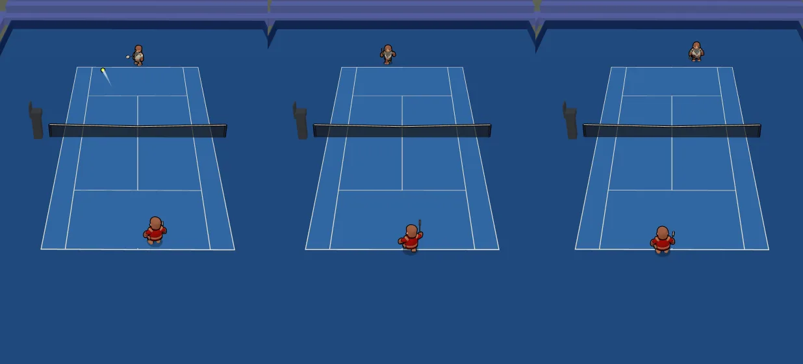
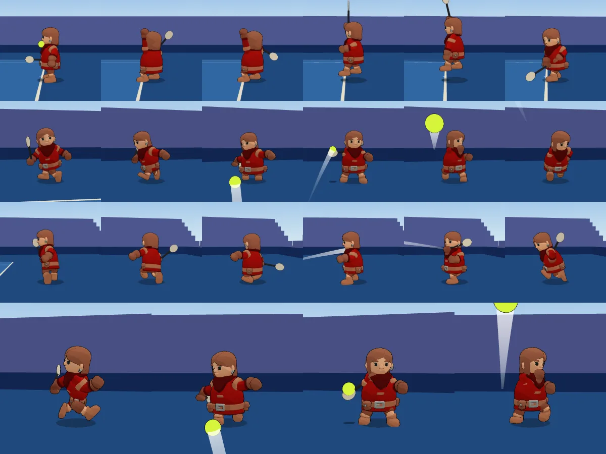
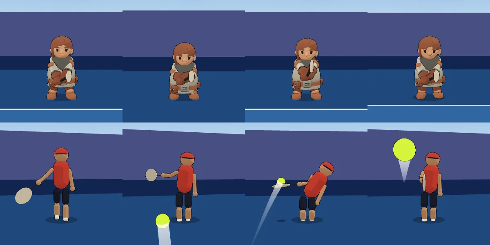

# M8: character and motion that read at the TV camera

> **요약 (한국어)**
> - **현황 (2026-10-18, origin/main 1d97946):** 기본 캐릭터는 ADR-024의 Pop 몸체(KayKit Rogue, CC0, 4,263 삼각형, 변형 본 20개)이고, 스트로크는 이펙터 키포즈를 IK로 풀며, 이동·리액션은 KayKit 클립 6개(Idle, Walk, Walk back, Run, Cheer, Hit_A)를 시간으로 샘플링한다. 그런데 10-17 기기 테스트 뒤 카메라가 **고정 TV 뷰 하나**로 돌아갔다(presentation spec C1). 캐릭터 작업은 체이스 카메라(내 선수 85px)와 클로즈업·임팩트 슬로모를 전제로 설계됐지만, 지금 폰에서는 가까운 선수가 **약 41px**, 먼 선수가 **약 29px**(§7 측정값)이고 클로즈업은 하나도 나오지 않는다.
> - **진단:** (1) 50px에서 읽히는 것은 실루엣뿐인데, 큰 머리와 짧은 팔 때문에 스트로크를 해도 실루엣이 거의 바뀌지 않고, 라켓은 1~2px 선이다. (2) 판단 홀드에 들어가고 나올 때 몸이 한 프레임에 튄다(라켓 헤드 0.8m, 본 1.9rad). (3) 랠리 프레임의 57%는 스트로크가 없어 KayKit 무기 들기 자세(라켓 헤드 높이 1.5m)로 뛴다. (4) 서브 토스 공이 손이 아닌 허공에서 나온다. (5) 스플릿 스텝은 몸 전체를 들어 올리는 것뿐이고, 발을 디딜 때 미끄러진다(p95 7.3cm). (6) 텔 자세 네 가지가 가까이서 봐도 거의 같다. (7) 옷은 판타지 모험가(후드, 벨트 주머니)를 다시 칠한 것이고 두 선수가 같은 몸이다. (8) 리액션은 두 클립뿐이고, Hit_A는 1.1초 동안 멈춘다.
> - **제안:** M8 = "TV 카메라에서 읽히는 캐릭터와 동작". 단계는 다음과 같다.
>   - 0단계: 측정 도구(TV 크기 콘택트 시트와 동작 연속성 테스트).
>   - A단계: 튐과 미끄러짐 제거(홀드 블렌드, 준비·캐리 레이어, 토스, 스플릿 스텝, 발 디딤, 비틀림).
>   - B단계: 50px 가독성(라켓, 팔 길이와 스윙 과장, 텔 실루엣, 이벤트 데이터 기반 스트로크 변주).
>   - C단계: 연기(결과별 리액션, 포인트 사이 동작, 시선).
>   - D단계: 테니스 복장과 선수 구분(프룬 스크립트로 KayKit 정리와 헤드기어 변형).
>   - 엔진·이벤트 스키마·카메라 규칙은 바꾸지 않는다. 클로즈업 복귀는 presentation spec에서 따로 결정한다.
> - **결정 (2026-10-18):** 사용자가 §6의 질문 10개를 전부 기본값으로 승인했다(ADR-031).

Accepted 2026-10-18 with every default of §6 (ADR-031). The analysis below is as of that day. Builds on `docs/3d-redesign.md` (the design study, §4–§5 and §9 as
built), ADR-023/024/030 and `docs/presentation-spec.md` (C1: one fixed TV camera). Images are in `docs/design/m8/`:
the rig viewer (`ui/rig.html`) and the replay page's stage at 412 px wide, DPR 2, seed 42 hard. Measurements marked
(m) were taken with throwaway scripts over a clay seed-2 exhibition (600 s of frames, both players) and the decision-hold
timelines in `trailing-walk.test.ts`.

## 1. Where it stands

| Layer | As built | Code |
|---|---|---|
| Body | KayKit Adventurers "Rogue" pruned to one character: 4,263 tris, 41 joints (20 animated, ~18 unused IK helpers), one 1024² palette PNG (16.7 KB), 326 KB glb | `renderer/cli/prune-player.ts`, `ui/public/models/player.glb` |
| Kit | Palette cells (0,1) shirt and (1,1) trim recoloured per player; head, hood, belt and pouches shared | `scene/kit.ts` |
| Racket | Cylinder handle (r 0.032 m) + disc head (r 0.16 m, aspect 0.8) on `handslot.r`, outline on the head only | `scene/gltfRig.ts:31-47`, `tuning/player.ts:28` |
| Root | Eased shot-to-shot positions; facing eases to the ball over 0.4 s, `turnToShot` swings it to the target | `playback/movement.ts`, `facing.ts`, `pose.ts:85-95` |
| Clips | Idle, Walking_A, Walking_Backwards, Running_A phased by distance over stride; Cheer and Hit_A from the landing, clamped then held | `scene/clipSampler.ts`, `gltfRig.ts:88-106` |
| Strokes | Effector keys per wing (`STROKE_KEYS`) eased in 0.12 s, out 0.45–0.75 s after contact; planted stance, lunge, serve hop | `playback/stroke.ts`, `tuning/strokes.ts` |
| IK | Pelvis/chest yaw and lean, hip drop; two-bone legs onto the plant; racket arm two-bone + ≤ 15 % stretch, wrist straight; free arm to its key; up to 3 crouch passes | `scene/strokeSolver.ts` |
| Hold | The decision hold's tell stance = a stroke with no contact (`READY_STANCE` + cue) | `playback/hold.ts` |
| Camera | One Main (TV) camera all match: 22 m up, 23 m behind on a phone (C1–C2) | `camera/mainCam.ts` |

What works: contact accuracy (p95 < 0.15 m), determinism, distance-phased strides (no slide while running), the toon
bands and constant-pixel ink, the 1× hybrid pace before and at decisions (ADR-030), and the desktop GPU budget (60 fps at
Pixel 7 size, TD-059 still open for phones).

## 2. What a player sees

Reproduce: `npm run dev`, then `/rig.html?point=3&shot=4&view=front&dt=-0.6,-0.35,-0.15,0,0.15,0.35`,
`/rig.html?point=3&shot=0&view=side&dt=-1.0,-0.6,-0.3,-0.1,0,0.25`, `/rig.html?point=3&hold=none,defend:1,counter:2,attack:0`,
`/rig.html?point=26&shot=2&dt=-0.35,-0.15,0,0.15`.

## 3. Diagnosis

The redesign (ADR-024) was built for the K2 chase camera (my player about 85 px) plus close-ups, an impact slow motion
and a tell shot. The 2026-10-17 device test put the quick match back on one fixed TV camera, where the near player is
about 41 px (1 px ≈ 4 cm; §7 measured, first estimated at 45–50) and the far one about 29 px, seen from high behind and high in front. Everything below is
judged at that size first; "CU" marks problems that only show in a close-up, which the shipping mode no longer has.

### 3.1 Pops and glides (visible at TV size)
1. **The decision hold pops on entry and release.** `releasedPlayers` eases position and facing but takes the
   timeline's body at once (`hold.ts:84-95`); a test codifies it (`trailing-walk.test.ts:69`). (m) The racket head jumps
   0.76–0.81 m (about 23 px) and bones turn 1.8–1.9 rad in one frame at release; entering the hold jumps 0.80 m. This
   happens at every decision, the most-watched moment of the match.
2. **Foot glide while a plant blends in or out.** (m) Median 2.3 cm a frame, p95 7.3 cm, max 17 cm; below 0.6 m/s,
   where idle and walk blend, p95 4.8 cm. `feet.test.ts:33-35` skips exactly these frames (partial plant, stroke
   without plant, reaction), so TD-058's "p95 0.5 mm" holds for fully planted frames only.
3. **Twist flips.** (m) In 600 s, 189 frames where `handr` and 221 where `lowerlegl` turn more than 1 rad in one frame,
   some by π (the face sign test in `strokeSolver.ts:60-61`, antiparallel aims). Mostly CU, but a shin flip shows as a
   one-frame leg kink at TV size.

### 3.2 No tennis body between strokes (TV)
4. **57 % of in-play frames have no stroke**, so the pose is pure KayKit: (m) running carries the racket head 1.26–1.51 m
   up (median 1.48) like a sword, the receiver waits in Rogue Idle, and nobody is in a ready position.
5. **Split step** is a 0.12 m lift of the whole body on a linear triangle (`pose.ts:70-75`), mid-run too: no wider feet,
   no landing bend.
6. **Serve toss** starts 1.1 m up, straight under the contact point (`trajectory.ts:39-42`), not from the free hand.
   (m) Hand-to-ball 0.75 m at release, 1.8 m at the apex; the hand reaches only 1.54 m (the IK clamps the 1.9 m key).

### 3.3 Strokes do not read at 50 px (TV)
7. **Silhouette barely changes.** With a big head and short arms (arm 0.576 m), the swing stays inside the body's
   outline from behind and above; the head blob dominates. In the captures the forehand's contact frame is hard to
   tell from the ready frame except by the ball.
8. **The racket is a 1–2 px line** with a small pale disc: the handle (r 0.032 m) is about 2 CSS px wide,
   the head about 9 CSS px across, and it carries no outline on the handle.
9. **One stroke per wing.** The engine emits serve, return and drive only (TD-001; seed 42: 1,011 shots), and the
   renderer ignores what the events do carry: `speedKmh`, `spinRpm` and contact height (`from.z` 0.61–1.40 m) never
   change the keys, though `docs/3d-redesign.md` §5.3 planned for them. The backhand is one-handed; low balls are met
   with little crouch (the 0.66 m forehand in `strokes.webp`).
10. **The four tell stances look alike** (`holds.webp`): racket held at the chest, small changes in crouch and lean.
    The decision hold exists to show the tell, and at 30 px (the far opponent) none of them separates.

### 3.4 Acting (TV silhouette, CU face)
11. **Two reactions for every outcome:** Cheer, or Hit_A used as "dejected", which plays 0.67 s and then freezes for about
    1.1 s. No fist pump by tag, no racket tap, no ball bounces before a serve, no walk-back business.
12. **Head never looks at the ball** (m: median 95° off at contact). CU only.

### 3.5 Look and identity (TV)
13. **A fantasy adventurer, recoloured.** Hood, bandana, belt with pouches, tunic: it reads as a rogue, not a tennis
    player. Both players share every mesh; only the shirt and trim cells differ (TD-062, TD-073 on the skinned rig).
14. **Close-up-only work is idle.** The face, the smear, the impact star and hit-stop (TD-063) never show in the quick
    match under C1/C4.

### 3.6 What the tests cannot see
Positions are checked (contact p95, racket-head jump < 0.7 m a frame against a measured max of 0.68 m, stride length,
fully planted feet), orientations are not. Nothing checks bone twist rate, the hold boundaries, the toss hand against
the ball, racket height between strokes, the racket through the body, head look, or anything in screen space. One
fixture match, first 300 s.

## 4. Principles for M8
- **Judge at the TV camera.** Every visual target is stated in pixels at the Main camera on a 412 px stage (DPR 2) or
  as a pose-space proxy for it. Close-ups are out of scope until the presentation spec brings one back.
- **No pops.** A body never jumps: per-frame racket-head and bone-angle bounds hold across every boundary (stroke in
  and out, plant, clip switch, hold in and out, reactions).
- **Same architecture.** Closed-form poses from replay time (ADR-007), effector keys + IK (ADR-024 D2), no engine or
  event-schema change, no new runtime dependency. New keys live in `renderer/src/tuning/`.
- **Test-first with measurable motion.** Each step lands with the metric that would have caught its problem.

## 5. Plan

Each step is one local commit, test first (CLAUDE.md rule 3 applies to the renderer's motion as a habit, as in
ADR-023/024). Steps inside a phase are mostly independent; phases run in order because A's harness guards B–D.

### Phase 0: see and measure
| Step | What | Done when |
|---|---|---|
| 0.1 | `npm run shots`: a Playwright script (existing dependency) that writes TV-size and rig-viewer contact sheets for fixed seeds and moments to a git-ignored folder, so every later step has a before/after | Sheets for 3 seeds × {serve, forehand, backhand, low ball, run, hold ×4, reaction}; runs in < 60 s on the VM |
| 0.2 | Motion continuity harness: per-frame racket-head jump, bone angular velocity (all deform bones), foot slip for any foot under 3 cm, over 3 matches × 3 surfaces, at 60 fps, *including* hold entry/release and reactions | Test lists today's violations as expected failures (`it.fails`) so each A step flips one to passing |

### Phase A: no pops, no glides
| Step | What | Metric |
|---|---|---|
| A1 | Blend into and out of the hold: the stance cross-fades over `HOLD_RELEASE_SEC` from the timeline's body (closes the new TD-078) | Racket head < 0.10 m and bones < 0.3 rad a frame across both boundaries |
| A2 | Carry and ready layer whenever no stroke owns the body: racket in front, free hand on the throat, lower carry at run speed, receiver's ready crouch from the server's toss; strokes blend from it | Racket head 0.6–1.2 m up between strokes (from 1.48 m median); contact p95 unchanged |
| A3 | Serve toss from the free hand: `tossPosition` starts at the hand key's position, hand keys follow the ball up | Hand-to-ball < 0.10 m at release; hand ≥ 1.7 m at −0.45 s |
| A4 | Split step: hop with its apex just before the opponent's contact, land on it with wider feet and a knee bend; none above ~2 m/s | Landing ±1 frame of contact; feet ≥ 0.5 m apart; no hop while running |
| A5 | Plant as a step: the foot lifts along an arc into and out of the plant (as the lunge does) or waits for the clip's next foot contact | Grounded-foot slip p95 < 2 cm including ramp frames (from 7.3 cm) |
| A6 | Twist continuity: the face sign from the key's direction, not a sign test; no antiparallel aims | `handr`, `lowerarm*`, `lowerleg*` < 0.5 rad a frame; tighten the racket jump bound to 0.35 m |

### Phase B: read at 50 px
| Step | What | Metric |
|---|---|---|
| B1 | Racket legibility: thicker handle with its own hull, a larger head with a dark frame and light strings (tuning only) | Head ≥ 14 CSS px and handle ≥ 3 CSS px at the near player on the TV camera |
| B2 | Silhouette: longer arms (bone scale, within the IK reach and contact tests), bigger unit turn, backswing and follow-through extension, free arm out (Tennis Clash's x ≈ 0.5–0.6 m) | Racket-tip travel at the TV camera ≥ 40 px over a groundstroke; hand-out-of-body-outline frames measured in pose space |
| B3 | Tell silhouettes: each tell gets one big, distinct cue (deep crouch, racket high, weight forward, open stance), readable on the far player | Pairwise projected-joint distance between stances ≥ 6 px at the far player (today: measure in 0.2) |
| B4 | Variety from event data: two-handed backhand, low and high variants by `from.z`, swing size by `speedKmh`, low-to-high finish by `spinRpm`, face tilt | Key choice deterministic; contact p95 unchanged; the two-hander's free hand ≤ 0.15 m from the handle |

### Phase C: acting
| Step | What | Metric |
|---|---|---|
| C1 | Reactions as effector keys by outcome and tags (fist pump on a winner, bigger on break/set/match point, head down and racket drop on an unforced error, racket tap), picked by a hash of the point index; Hit_A retired | No frozen span (pose delta > 0 every frame of a reaction); same seed, same pick; ≥ 4 reactions in a match |
| C2 | Between-point business on the walk back and before a serve: ball bounces (2–3, from the free hand), towel-free idle shuffles | Visible in the hybrid edit's 1× point-before-decision span; continuity harness passes |
| C3 | Head look at the ball within a clamp (also feeds a future CU) | Head-to-ball < 40° at contact |

### Phase D: a tennis player, two people
| Step | What | Metric |
|---|---|---|
| D1 | Clean the KayKit body in `prune-player.ts`: drop the belt, pouches and hood triangles by their palette cells, recolour the bandana as a collar, shorts and shoes as kit cells (no Blender) | glb ≤ 326 KB, tris ≤ 4,263; no rogue items in the rig viewer |
| D2 | Identity at 30 px: two or three headgear/hair meshes (cap, headband, hair) and a skin and shoe swatch per player, from `PlayerProfile` by a hash until GDD player creation adds fields (TD-073) | Players A and B differ in hue *and* silhouette at the far player; draw budget ≤ 110 (high) |
| D3 | Decide the final character route (modified KayKit vs TRELLIS on the B200 re-skinned vs a commission, `docs/3d-redesign.md` §8) from the D1–D2 result | A recorded decision, not code |

### Close
Device check on the user's phone (TD-059 frame times and an eye check of the sheets), ADR-031, tech-debt pass
(CLAUDE.md rule 9), `docs/3d-redesign.md` §9 and the presentation spec updated.

**Out of scope:** the camera and editing rules (presentation spec C1–C4, E*; a close-up or replay angle needs a spec
change first), new engine shot types (TD-001: volley, slice, lob, drop, overhead), the career match's mannequin
pipeline (TD-064), the A1 sunny-club arena (`docs/3d-redesign.md` §6), commissioned assets.

## 6. Questions (each with a default)
1. **Milestone:** call this M8 and run it on the renderer while M7's device work continues (no shared files except
   `docs/`)? *Default: yes.*
2. **Camera assumption:** design every target for the fixed TV camera and leave close-up-only polish (face, wrist,
   smear) alone? *Default: yes.*
3. **A close-up moment:** propose one presentation-spec rule (a low replay angle of the decisive point at set or match
   point only) alongside M8? *Default: no, keep M8 camera-free; revisit after the device check.*
4. **Proportions:** lengthen the arms (and, if needed, the legs) by bone scale for a bigger swing silhouette, moving away
   from 3 heads toward about 3.5? *Default: yes, arms up to +20 %, legs as the reach tests require.*
5. **Racket size:** exaggerate the racket for the TV camera (head radius 0.16 → about 0.20 m, handle 0.032 → 0.045 m)?
   *Default: yes.*
6. **Backhand:** two-handed for everyone (the commoner modern stroke, and the free hand on the grip reads at 50 px), or
   a per-player choice by hash? *Default: two-handed for everyone; one-handed later with player creation.*
7. **Tell cues:** make the tells deliberately theatrical (Mario-style) rather than subtle? *Default: yes, one big cue
   per tell.*
8. **Character clean-up:** D1–D2 in code on the KayKit body now, final look decided after? *Default: yes.*
9. **Speed of card-less rallies:** they still run at 2× before the last 0.7 s (`QUICK_PACE.hybrid.fastSpeed`), halving
   how long a stroke reads. Leave pacing to the presentation spec? *Default: leave it; M8 does not touch pace.*
10. **Review loop:** after phases A and B, send the contact sheets (0.1) and a phone build for an eye check before C
    and D? *Default: yes.*

## 7. Baseline (2026-10-18, before phase A)

`npm run motion` (seed 2 clay, 1 grass, 3 hard; first 300 s; both players; 60 fps; the decision holds of a tiebreak
played point by point) and `npm run shots -- --label baseline` (24 sheets, not committed: `shots/` is ignored). The
continuity targets are `it.fails` in `renderer/tests/motion-continuity.test.ts` until the step named.

| Per frame | p50 | p95 | max | Target (step) |
|---|---|---|---|---|
| Racket head in play, m | 0.042 | 0.243 | 1.078 | < 0.35 (A6) |
| Twist bones (hand, forearms, shins), rad | 0.138 | 1.004 | 3.141 | < 0.5 (A6); 5,438 of 108k frames over 1 rad |
| Racket head into the hold, m | 0.804 | 1.470 | 1.547 | < 0.10 (A1) |
| Largest bone turn into the hold, rad | 1.889 | 1.959 | 2.055 | < 0.3 (A1) |
| Racket head out of the hold, m | 0.053 | 1.054 | 1.625 | < 0.10 (A1) |
| Largest bone turn out of the hold, rad | 0.085 | 0.657 | 3.142 | < 0.3 (A1) |

| Grounded foot slip per frame, m | p50 | p95 | max |
|---|---|---|---|
| Run | 0.005 | 0.041 | 0.306 |
| Walk | 0.006 | 0.041 | 0.249 |
| Idle | 0.000 | 0.014 | 0.224 |
| Planted | 0.000 | 0.000 | 0.036 |
| Plant ramp (target p95 < 0.02, A5) | 0.021 | 0.067 | 0.181 |
| Stroke, no plant | 0.000 | 0.026 | 0.125 |
| Reaction | 0.006 | 0.036 | 0.121 |

| Carry and toss | Today | Target (step) |
|---|---|---|
| Racket-head height without a stroke or reaction, p5 / p50 / p95 | 0.62 / 1.12 / 1.53 m | p5 > 0.6, p95 < 1.2 (A2) |
| Free hand to ball at the toss's release | 0.79 m (all 108 serves) | < 0.10 (A3) |

| On the TV view (412×503 CSS px) | Today | Target (step) |
|---|---|---|
| Body height, near / far player, ready stance | 41.3 / 28.6 | — |
| Racket head, near player | 8.4 | ≥ 14 (B1) |
| Racket-head span around the feet over a near groundstroke (−0.6 to +0.4 s), p50 of 49 | 48.9 | ≥ 64, +30 % (B2) |
| Tell stances on the far player: mean joint distance, min / p50 of the 45 pairs | 0.3 / 6.0 | min ≥ 6 (B3) |

Found by the baseline, beyond §3: the racket jumps up to 1.08 m in a frame in the grass and hard matches
(`strokeRig.test.ts` holds 0.7 m on its clay fixture only), and the twist flips reach the hips and spine (up to 2.8 rad)
and the feet (3.1 rad) as well as the hand and shins.
